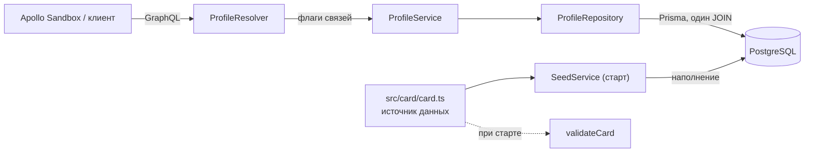
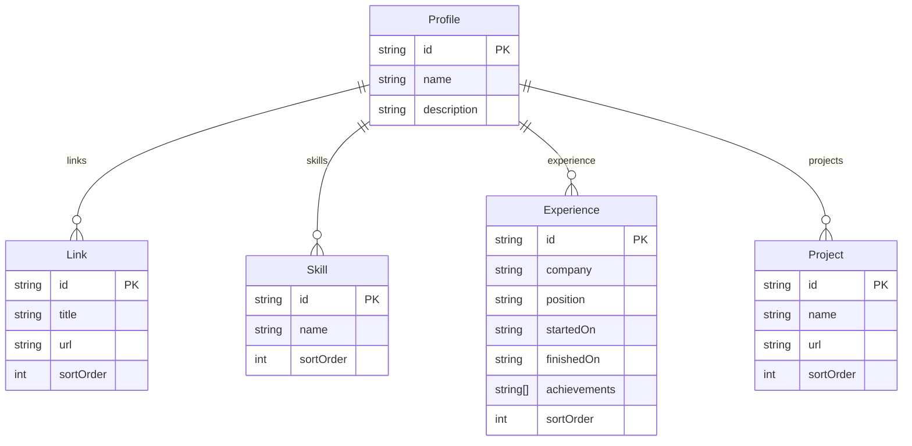

# Цифровая визитка

Backend-визитка: профиль разработчика живёт в PostgreSQL, наружу смотрит GraphQL API, а песочница Apollo Sandbox — это клиент того же API. Один источник данных, никакого дублирования в разметке.

Стек: TypeScript, Node.js, NestJS, Prisma, PostgreSQL, GraphQL, Docker.

- Песочница: <https://maxim-zozulya-card.fly.dev/graphql>
- Локально после запуска: <http://localhost:3000/graphql>

## Запуск

С пустой машины нужен только Docker:

```bash
docker compose up --build
```

Команда поднимает PostgreSQL, накатывает миграцию Prisma, наполняет визитку и запускает API на <http://localhost:3000/graphql>. Пароль базы `card` задан в `docker-compose.yml` и нужен только локальному контейнеру.

## Что спросить у API

```graphql
query {
  profile {
    name
    description
    links {
      title
      url
    }
    skills {
      name
    }
    experience {
      company
      position
      period
      achievements
    }
    projects {
      name
      url
    }
  }
}
```

## Структура

| Задача | Файл |
| --- | --- |
| Имя, описание, ссылки, навыки, опыт, проекты | `src/card/card.ts` |
| Проверка карточки перед записью | `src/card/validate-card.ts` |
| Таблицы | `prisma/schema.prisma` |
| Наполнение базы при старте | `src/seed/seed.service.ts` |
| Чтение из базы | `src/profile/profile.repository.ts` |
| Сборка ответа | `src/profile/profile.service.ts` |
| Схема GraphQL | `src/profile/profile.model.ts`, `profile.resolver.ts` |
| Порт, путь GraphQL, подпись периода, SQL-лог | `src/config/configuration.ts` |

## Как устроено

Запрос проходит через три слоя, и каждый отвечает за одно. Клиент отправляет GraphQL, резолвер смотрит, какие связи запрошены, репозиторий читает из базы только их, сервис собирает ответ.



Данные живут в одном объекте `card.ts`. При старте `SeedService` проверяет его и переписывает в базу. Таблицы связаны с профилем один-ко-многим и читаются в порядке `sortOrder`.



## Архитектурные решения

**GraphQL по code-first.** Схема генерируется из классов TypeScript (`profile.model.ts`), отдельного SDL-файла нет. Источник один, поэтому схема и код не расходятся, а хранить в git копию, которая устареет, незачем.

**Данные отделены от кода.** Все факты лежат в одном объекте `src/card/card.ts`. Остальной код их только читает. Правка визитки — это правка одного файла, а не разметки, запросов и миграций одновременно.

**Три слоя с узкой ответственностью.** `ProfileRepository` знает только про Prisma и возвращает строку. `ProfileService` берёт строку и готовит вид для GraphQL; единственное преобразование здесь — склейка периода из двух месяцев. `ProfileResolver` переводит выборку GraphQL во флаги связей и вызывает сервис. Бизнес-логика не знает про Prisma, доступ к данным не знает про GraphQL.

**Вложенные списки читаются по требованию.** Запрос `{ profile { name } }` читает одну строку `Profile` и не трогает таблицы ссылок, навыков, опыта и проектов. Резолвер смотрит поля запроса (`selection.ts`) и передаёт в репозиторий флаги связей. В `include` попадает только запрошенная связь. В `schema.prisma` включён preview `relationJoins`, поэтому запрошенные списки приходят одним SQL с JOIN (`relationLoadStrategy: 'join'`), а не отдельным запросом на каждую связь. Профиль здесь один, поэтому проблемы N+1 и DataLoader не возникает; появись список профилей — первым делом добавился бы DataLoader.

**Список связей задан один раз.** Массив `NESTED_FIELDS` в `selection.ts` — единственное место, где перечислены вложенные списки. Из него выводятся и тип флагов, и их разбор, так что новое поле не придётся прописывать в нескольких местах.

**Наполнение базы идемпотентно.** `SeedService` при старте проверяет карточку через `validateCard` и в одной транзакции переписывает её в базу: профиль обновляется на месте, списки заменяются целиком. Повторный запуск не плодит дубли, а битые данные роняют старт с понятной ошибкой вместо тихой записи мусора.

**Запись только через сид.** Мутаций в API нет осознанно: запись через GraphQL разошлась бы с `card.ts`, и при следующем старте сид всё равно затёр бы её. Источник правды один.

## Как добавить данные

Навык, ссылка, проект, место работы или пункт в достижениях — одна запись в соответствующем массиве `src/card/card.ts`. Порядок в массиве становится порядком в ответе. После правки нужен перезапуск, чтобы сид записал новое значение:

```bash
docker compose up --build
```

Для правки без пересборки образа поднимите базу в Docker, а сервер — в watch-режиме:

```bash
docker compose up -d postgres
copy .env.example .env   # на Linux/macOS: cp .env.example .env
npm install
npm run start:dev
```

Сохранили `card.ts` — Nest перезапустился и сид записал новое значение.

Новое текстовое поле профиля повторяет путь поля `description`:

1. Колонка в `prisma/schema.prisma`.
2. `npx prisma migrate dev --name field` при запущенном PostgreSQL.
3. Поле в типе и в объекте `src/card/card.ts`.
4. Поле в `profile.model.ts`.
5. По одной строке в `profile.repository.ts` и `profile.service.ts`.

## Проверки

```bash
npm test          # юнит-тесты сервиса, конфигурации, валидации и разбора запроса
npm run build     # генерация клиента Prisma и сборка Nest
```

CI (`.github/workflows/test.yml`) на каждый push ставит зависимости, прогоняет тесты и собирает проект.
